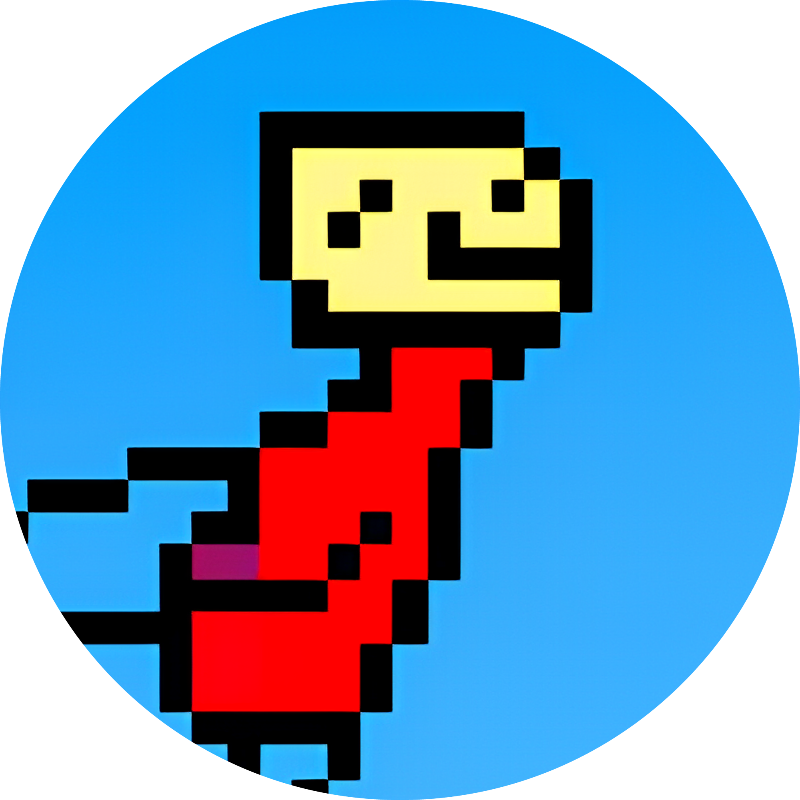
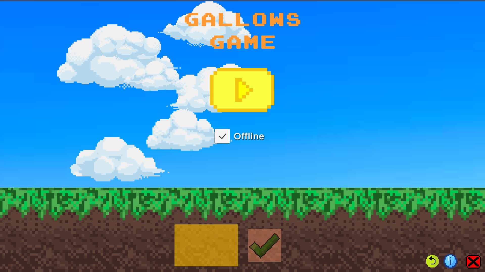
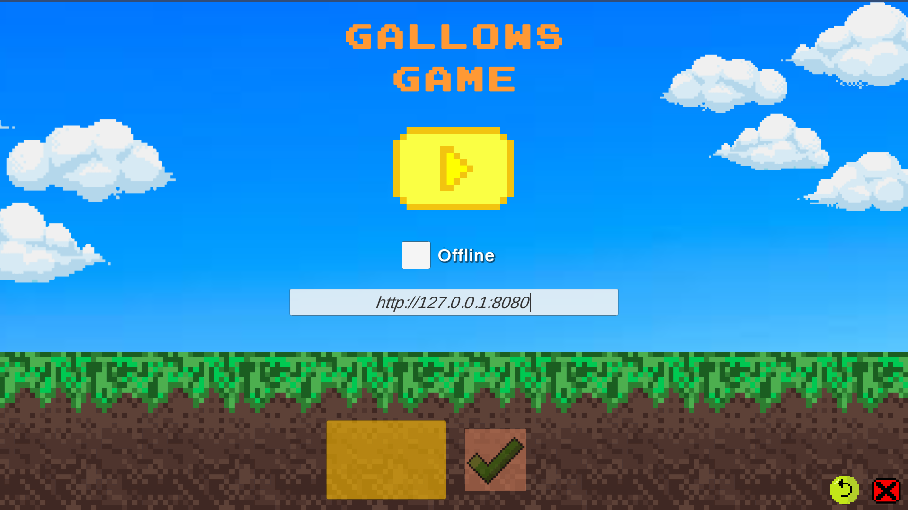
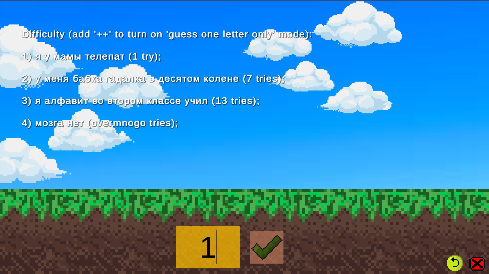
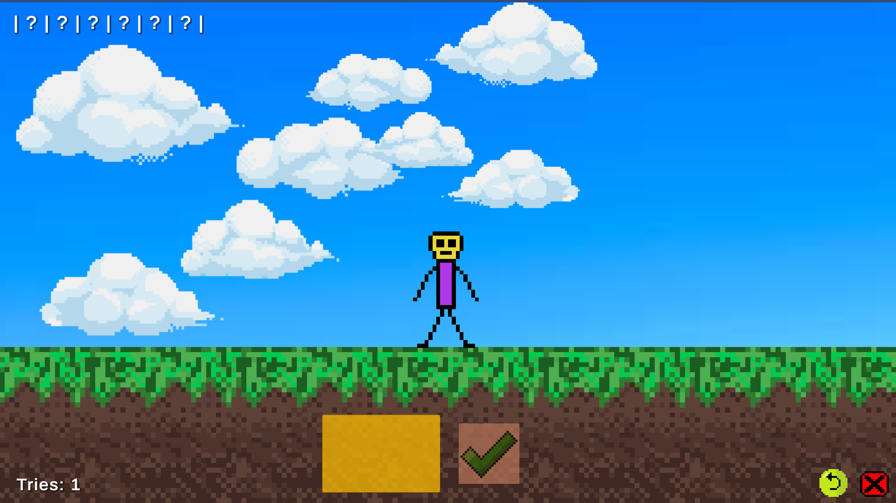
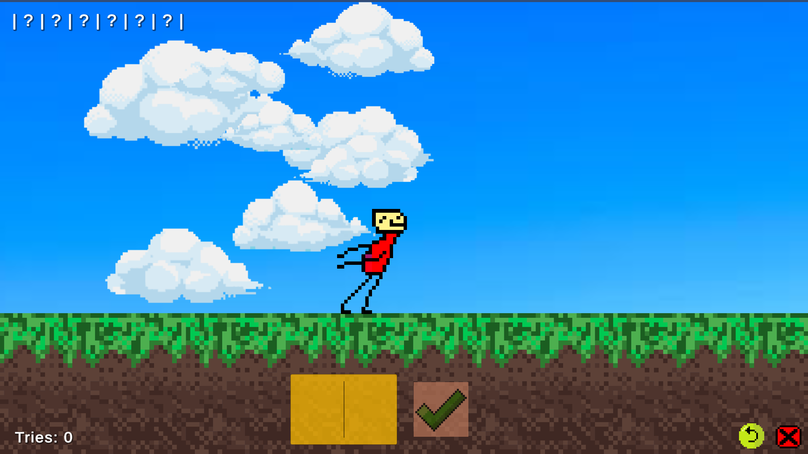
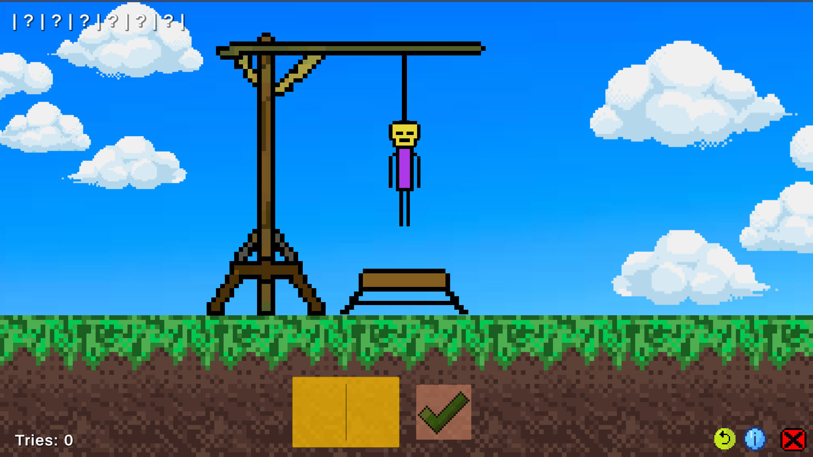
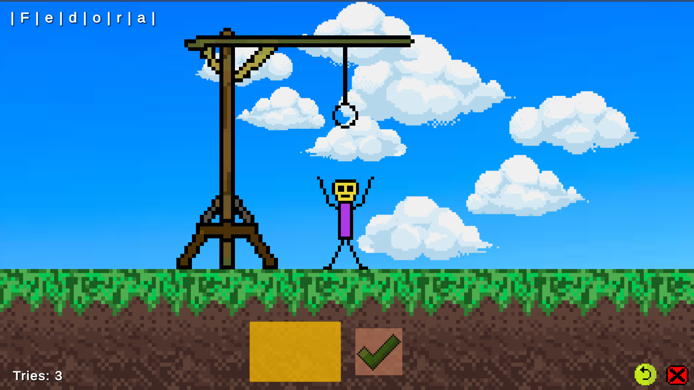

# GallowsGame

<p align="center">
  <a href="https://andrew1407.github.io/GallowsGame/">
    
  </a>
</p>

[](https://github.com/andrew1407/GallowsGame/actions/workflows/main.yml)
[](https://github.com/andrew1407/GallowsGame/actions/workflows/pages.yml)

**GallowsGame (Hangman)** is a 2D sprite game with:

+ 4 difficulty levels;
+ [offline](./Assets/Scripts/Gameplay/Offline/OfflineStrategy.cs) mode;
+ online mode, 4 clients (using **[gallows-remastered API](https://github.com/Andrew1407/gallows-remastered)**):
  + [HTTP](./Assets/Scripts/Gameplay/Online/HttpClientStrategy.cs).
  + [WebSocket](./Assets/Scripts/Gameplay/Online/WebSocketClientStrategy.cs).
  + [UDP](./Assets/Scripts/Gameplay/Online/UdpClientStrategy.cs).
  + [TCP](./Assets/Scripts/Gameplay/Online/TcpClientStrategy.cs).

## Gameplay

Play offline:



Play online:



Choose difficulty:



Main gameplay (wordguessing):



Loss cases:





Win case (guess a word):



## Tests

1. [EditMode](./Assets/Tests/EditMode): the game rules, the offline strategy, difficulty stats, payload (de)serialization, all four online clients (HTTP against a fake handler; TCP, UDP and WebSocket against loopback servers), the strategy factory, resources, the gameplay components and how lost tries map onto hanger and body parts (checked against the hanger prefab).
2. [PlayMode](./Assets/Tests/PlayMode): the UI and the game flow: the game loop (stage chaining, input handling, restart), the start menu (offline start, online toggle, address validation), text tabs, stage coroutines and the view controllers.

Run them from **Window → General → Test Runner** or headless:

```sh
Unity -batchmode -projectPath . -runTests -testPlatform EditMode -testResults editmode.xml
Unity -batchmode -projectPath . -runTests -testPlatform PlayMode -testResults playmode.xml
```

## Building locally

Use the **Build** menu in the editor, or [build.ps1](./build.ps1) to build with the project's Unity version in batch mode and zip the results into `dist/` (close the project in the editor first):

```powershell
./build.ps1                                       # Windows + WebGL
./build.ps1 -Platforms Windows,Linux,macOS,WebGL  # every platform whose build support module is installed
```
